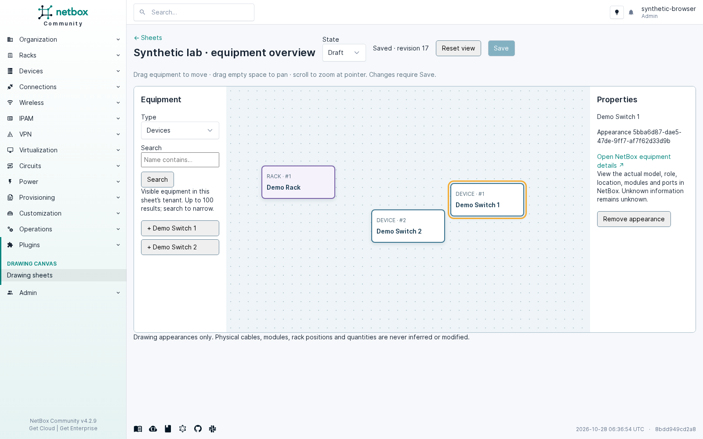

# NetBox Drawing Canvas

An independently installable plugin. One `Drawing` record is one sheet: tenant, title,
optional site/location, draft/review state, revision, source reference and a versioned
scene. Place existing devices/racks on multiple sheets without duplicating equipment.
No NetBox core changes or production deployment are required.



## Use

Open **Plugins → Drawing sheets**, create a sheet, search its tenant’s equipment and
click a result to place it. Click an appearance to open its property panel and the
actual NetBox equipment detail page (model, role, location, modules and ports).
Drag equipment; drag empty space to pan; scroll to zoom around the pointer.
**Save** explicitly persists positions and state. Unsaved changes are indicated and
navigation is guarded. Removing an appearance does not delete equipment.

A stale save returns HTTP 409 and keeps local edits dirty. Reopen the sheet to load
the latest revision before reapplying edits. There is no automatic conflict merge.
The database row lock ensures only one save for a given revision succeeds.

## Compatibility

The plugin uses `PluginConfig`, `NetBoxModel`, `RestrictedQuerySet.restrict()`,
`register_model_view()`, plugin menus/templates/static assets, and NetBox serializers.
It avoids newer `PrimaryModel` APIs. The initial migration was generated by Django
5.1.8 against NetBox 4.2.9, preserving the oldest tested migration dependencies.

The allowed version range is **4.2.9–4.7.4**. Validation results are recorded in
[VALIDATION.md](VALIDATION.md). Intermediate releases are not separately certified.
The engineering checkout identifies itself as 4.7.4; the repository’s general
AGENTS.md version description is older. Python 3.12 is used for local validation.

## Install into a separate development NetBox

Do not use a live installation or database for these commands.

```sh
/path/to/isolated-venv/bin/pip install ./engineering/netbox_drawing_canvas
```

Add `netbox_drawing_canvas` to that instance’s `PLUGINS`, then run its `manage.py
migrate` and `collectstatic --noinput`. Restart only that isolated development
process. The wheel includes the migration, templates and JavaScript; there is no
JavaScript build step and no new runtime dependency beyond NetBox’s dependencies.

## Reproduce the isolated demo

Requirements: Python 3.12, PostgreSQL 15+ binaries, Redis, and a disposable NetBox
source checkout. All commands below run from this plugin directory. Install NetBox’s
pinned requirements into a new virtualenv; `psycopg[binary,pool]` may replace
`psycopg[c,pool]` at the **same pinned version** when no compiler/libpq headers are
available. This substitution was used for local validation.

```sh
export NETBOX_SRC=/absolute/path/to/disposable/netbox
export DRAWING_PYTHON=/absolute/path/to/isolated-venv/bin/python
export DRAWING_DEV_STATE=/absolute/path/to/private/drawing-dev-state
export PG_BIN=/usr/lib/postgresql/15/bin
export DRAWING_DEV_DB_USER="$(id -un)"
# For 4.2.9 use drawing_canvas429; for engineering use drawing_canvas.
export DRAWING_DEV_DB=drawing_canvas429

./dev/start-services.sh
./dev/manage.sh migrate --noinput
./dev/manage.sh drawing_demo
./dev/manage.sh createsuperuser
./dev/manage.sh runserver 127.0.0.1:8009 --noreload
```

Open **http://127.0.0.1:8009/plugins/drawing-canvas/** and log in with the local user
created above. The synthetic fixture contains a tenant, site, rack, two switches,
and a saved drawing. It deliberately creates no ports, modules, cable endpoints,
rack positions or purchase quantities. Run `drawing_demo` again safely to find the
existing sheet. It refuses to run unless the plugin’s `synthetic_demo` setting is true.

The launcher explicitly sets `NETBOX_CONFIGURATION=drawing_dev`; it cannot inherit
a production configuration. It connects only to loopback PostgreSQL **55439** and
Redis **56389**, using dedicated databases and private state outside the repository.
The example database trusts local connections and the example secret is public:
this configuration is exclusively for a private synthetic development environment.
No background workers or production jobs are launched.

To stop just these services, stop runserver, then:

```sh
"$PG_BIN/pg_ctl" -D "$DRAWING_DEV_STATE/pgdata" stop
kill "$(cat "$DRAWING_DEV_STATE/redis.pid")"
```

## Checks

The fork's `Drawing canvas` GitHub Actions workflow runs this plugin's backend and
browser checks on NetBox 4.2.9 and 4.7.4 when plugin files change. It uses synthetic
data and an isolated PostgreSQL/Redis pair. This supplements core CI, whose path
filters do not cover this plugin directory.

```sh
./dev/manage.sh check
./dev/manage.sh test netbox_drawing_canvas.tests --keepdb --noinput
./dev/manage.sh makemigrations netbox_drawing_canvas --check --dry-run
ruff check .
node --check netbox_drawing_canvas/static/netbox_drawing_canvas/canvas.js
```

For the real-browser smoke test, install Playwright in the same isolated virtualenv
and its Chromium browser/system libraries. Keep runserver running:

```sh
"$DRAWING_PYTHON" -m pip install playwright
"$DRAWING_PYTHON" -m playwright install --with-deps chromium
export DRAWING_DEV_URL=http://127.0.0.1:8009
export DRAWING_SCREENSHOT=/tmp/drawing-canvas-smoke.png
./dev/manage.sh shell < dev/smoke.py
```

This uses an in-memory login for a synthetic passwordless test user; it does not
persist browser session files or tokens. It exercises placement/removal, dragging,
pan/zoom, explicit save/reopen, the detail link, navigation guard, and conflicting
saves from two browser tabs. Screenshot output contains synthetic data only.

## Permissions and tenant policy

Tenant membership is not authorization. Each endpoint requires authentication and
NetBox object permissions, including any configured constraints:

- Listing/opening a sheet requires `view_drawing` for that sheet **and** `view_tenant`
  for its tenant. Saving also requires `change_drawing` for that sheet.
- Creation requires `add_drawing`; constraints are checked against the saved row
  within a transaction and a denial rolls back the insert.
- Site/location choices require their own view permissions. Site and location must
  belong to the sheet’s tenant, and location must belong to the selected site.
- Every referenced device/rack requires its own `view_device`/`view_rack` permission
  and an exact tenant match. An unrestricted equipment permission does not bypass
  tenant validation. Null-tenant equipment/sites/locations are **not eligible**.
  Drawing tenant is mandatory. Shared/null-tenant infrastructure is intentionally
  unsupported in this slice.
- If referenced equipment is deleted, reassigned or becomes inaccessible, scene
  reads fail closed and saves reject it. An authorized administrator must repair
  the sheet; hidden references are never silently removed or overwritten.
- Equipment properties link to NetBox’s permission-checked detail view instead of
  serializing unrestricted related objects into the canvas.
- The discovery REST API is read-only. Revision-checked scene writes use the
  session-authenticated, CSRF-protected editor endpoint. No generic write endpoint
  bypasses revision checks. Configuring NetBox exempt-view permissions affects
  `.restrict()` as it does elsewhere in NetBox; avoid exemptions for tenant data.

For a constrained editor, grant Drawing view/add/change with
`{"tenant_id": TENANT_ID}`, Tenant view with `{"id": TENANT_ID}`, and view permission
on the eligible Device/Rack/Site/Location records with the same tenant constraint.
Separate role/model/module/port permissions remain controlled by NetBox.

## Scene contract and limits

```json
{
  "schema_version": 1,
  "appearances": [
    {"id": "0c41b29a-ddb8-47d6-9210-21904d4710d5", "kind": "device", "object_id": 123, "x": 100, "y": 80}
  ]
}
```

UUIDs identify appearances within a sheet; equipment primary keys identify actual
NetBox objects. Names/tags are labels, never identity. Unknown fields, duplicate
appearance IDs, foreign/hidden/missing IDs, invalid kinds and nonfinite coordinates
are rejected. Limits: 500 appearances, 256 KB save requests, coordinates ±100,000.
Source references are optional plain-text portable metadata, never fetched or
uploaded. No confidential documents, data exports, tokens or database files belong
in this public package.

This first slice has one sheet per Drawing, free placement and links to equipment
properties. There are no routed connectors, cable writes, imports, history replay,
undo/redo, autosave, grouped drawing books, scene export, or metadata editing after
creation. Draft/review is a label, not an approval workflow. Scene schema version and
optimistic revision are stored; historical scene snapshots are not an editor feature.
Do not infer unknown ports, physical connections or procurement quantities from a
visual arrangement.

## Private-network preview in Docker

`dev/compose.preview.yml` creates separate database/cache/media/static volumes and
installs the plugin into a NetBox Docker image. It does not use an existing NetBox
database or configuration. The default published address is loopback; expose it
only on an intended private interface and use unique credentials. HTTP previews
are supported without the secure-context-only `crypto.randomUUID` API.
Preview session/CSRF cookies have distinct names so signing in does not replace
another NetBox instance's cookies on the same hostname at a different port.

Create an environment file outside this repository with permissions `0600`:

```text
NETBOX_IMAGE=netboxcommunity/netbox:v4.2.9
DRAWING_DB_PASSWORD=<unique random password>
DRAWING_SECRET_KEY=<unique random secret of at least 50 characters>
DRAWING_API_PEPPER=<unique random secret>
DRAWING_ADMIN_PASSWORD=<unique random login password>
DRAWING_BIND_ADDRESS=127.0.0.1
DRAWING_PORT=8009
DRAWING_ALLOWED_HOSTS=localhost,127.0.0.1,testserver
```

Run from the plugin directory:

```sh
docker compose -p netbox-drawing-preview --env-file /private/preview.env -f dev/compose.preview.yml up -d --build
docker compose -p netbox-drawing-preview --env-file /private/preview.env -f dev/compose.preview.yml exec netbox /opt/netbox/venv/bin/python /opt/netbox/netbox/manage.py collectstatic --noinput
docker compose -p netbox-drawing-preview --env-file /private/preview.env -f dev/compose.preview.yml exec netbox /opt/netbox/venv/bin/python /opt/netbox/netbox/manage.py drawing_demo
```

Sign in as `preview` using your environment file's admin password. The example
equipment and initial sheet are synthetic. The preview restarts automatically
with Docker; its state persists in the dedicated volumes. Stop it with the same
compose command followed by `stop`. Do not use `down -v` unless intentionally
discarding the preview database and uploaded files.
